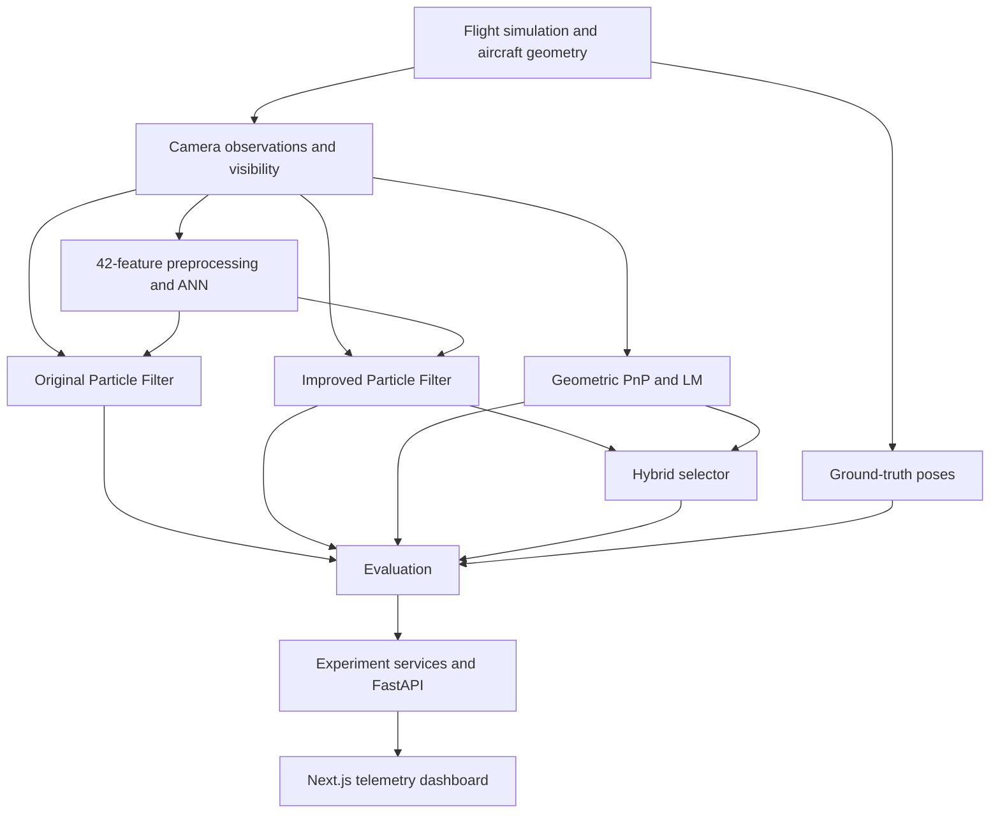

# Vision-Based Precision Pose Estimation for Autonomous Formation Flying

A research framework for **monocular aircraft-relative pose estimation**, combining synthetic flight simulation, ANN-assisted particle filtering, geometric PnP and an interactive telemetry dashboard.

**Python · PyTorch · OpenCV · FastAPI · Next.js · TypeScript · Plotly**

> **Scope:** This is a synthetic research demonstrator inspired by Rohan Punnoose's *Vision-Based Precision Pose Estimation for Autonomous Formation Flying*. It does not implement closed-loop flight control or establish performance on real aerial imagery or flight hardware.
>
> **Revision status:** Results below come from the **26 October 2026 audit**, prepared locally as correction commit `47bf3e2` on `audit/pose-integration-validation`, based on `a49f0fcca16131580a0f6318da8061cbb384af93`. At the time of this README update, those repairs have **not been published or merged into `main`**. This documentation update does not apply them. The 124-test result and corrected behaviors describe that audited revision; interactive browser acceptance remains outstanding.

## Contents

- [Overview](#overview)
- [Setup and running the application](#setup-and-running-the-application)
- [Architecture](#architecture)
- [Repository layout](#repository-layout)
- [Simulation and coordinate conventions](#simulation-and-coordinate-conventions)
- [Estimation methods](#estimation-methods)
- [Dataset and ANN training](#dataset-and-ann-training)
- [Measured results](#measured-results)
- [Research experiments](#research-experiments)
- [API and dashboard](#api-and-dashboard)
- [Testing and validation](#testing-and-validation)
- [Limitations and future work](#limitations-and-future-work)
- [Reproducibility](#reproducibility)
- [Three-minute demonstration](#three-minute-demonstration)
- [Reference and documentation](#reference-and-documentation)

## Overview

A follower aircraft must estimate the leader's relative position and orientation from two-dimensional camera measurements. Depth ambiguity, occlusion, image noise and coarse learned predictions make this a challenging continuous six-degree-of-freedom (6-DoF) estimation problem.

This project implements and compares four approaches:

| Method | Purpose |
|---|---|
| Original-method ANN-assisted Particle Filter | Refine coarse ANN predictions with inverse-MSE landmark likelihoods and ANN-informed proposals. |
| Improved Particle Filter | Investigate log-space Gaussian/outlier likelihoods, effective sample size and adaptive resampling. |
| Geometric PnP | Recover continuous pose from known 3D landmarks and observed 2D correspondences. |
| Hybrid estimator | Select a validated geometric pose, otherwise use the improved PF estimate. |

The platform supports synthetic observation generation, training, validation calibration, benchmarking, ablations, persistent experiments and synchronized playback. Ground truth generates observations and supplies training targets/calibration/evaluation references; **it is not an input to the ANN or Particle Filters during research inference**. Oracle fixtures are confined to tests.

## Setup and running the application

### Prerequisites

- Python **3.12** to match the audited environment.
- Node.js and npm compatible with the frontend's `package.json`.
- Storage for generated datasets, checkpoints and experiment outputs.

The audit used CPU inference/training. CUDA and Apple MPS paths were not independently validated.

### 1. Clone and install

```bash
git clone https://github.com/SudarshanG9/Vision-Based-Precision-Pose-Estimation-For-Autonomous-Formation-Flying.git
cd Vision-Based-Precision-Pose-Estimation-For-Autonomous-Formation-Flying/demo/pose-estimation-demo

python -m venv .venv
source .venv/bin/activate
python -m pip install -r requirements-dev.txt
```

On Windows, activate with `.venv\Scripts\activate` instead.

The current `main` requirements omit some runtime dependencies. Until the audit repairs are incorporated, also install:

```bash
python -m pip install torch opencv-python-headless scipy
python -m pip check
```

**Use the audited corrections to reproduce the corrected test and integration results.** Do not assume `git switch audit/pose-integration-validation` works in a fresh clone while that branch remains unpublished. The original test suite has a collection error involving the missing `linear_trajectory` helper; the audit repairs address it.

### 2. Generate the trained artifacts

From `demo/pose-estimation-demo/`:

```bash
python -m training.generate_dataset --config configs/training.yaml
python -m training.train_classifier --config configs/training.yaml
python -m training.calibrate_classifier
python -m training.validate_models
python -m scripts.verify_installation --strict
```

Datasets, model checkpoints and benchmark outputs are generated locally and excluded from ordinary source tracking. Their absence in a fresh checkout does not mean training code is broken. An alternative is to obtain the audited artifact package and extract its `data/processed/` and `checkpoints/` directories into the application root.

Keep the test split out of training, checkpoint selection and residual calibration.

### 3. Start the backend

In the application root:

```bash
python -m uvicorn api.main:app --host 127.0.0.1 --port 8000
```

- API base: [http://127.0.0.1:8000/api/v1](http://127.0.0.1:8000/api/v1)
- Interactive API documentation: [http://127.0.0.1:8000/docs](http://127.0.0.1:8000/docs)

Use **one backend worker**. The local experiment store is not a distributed job queue.

### 4. Start the dashboard

Open another terminal at the repository root:

```bash
cd demo/pose-estimation-demo/frontend
npm install
npm run dev -- --hostname 127.0.0.1
```

For a production build:

```bash
npm run test
npm run start -- --hostname 127.0.0.1
```

Open [http://127.0.0.1:3000](http://127.0.0.1:3000). The default API URL is `http://127.0.0.1:8000/api/v1`; set `NEXT_PUBLIC_API_URL` before building if needed.

**Artifact-free PnP:** The audited correction supports geometric-only experiments without ANN checkpoints. Current `main` still loads ANN artifacts unconditionally in the experiment runner; obtain the corrections before relying on that behavior.

## Architecture

PnP consumes the observed landmark correspondences directly; it does **not** depend on ANN predictions.



All estimators receive matching observations within a comparison. The dashboard displays stored results; scrubbing a completed experiment does not rerun estimation.

## Repository layout

The application root is **`demo/pose-estimation-demo/`**, not the repository root.

| Path within the application | Responsibility |
|---|---|
| `simulation/` | Aircraft geometry, rigid transforms, trajectories, projection, rendering and observations. |
| `models/` | Pose labels, visibility-aware preprocessing and ANN definition. |
| `training/` | Dataset generation, training, validation residual calibration and held-out evaluation. |
| `estimators/` | Shared contracts, original/improved PFs, PnP refinement and hybrid selection. |
| `evaluation/` | Metrics, comparisons, repeated-seed aggregation and ablations. |
| `services/` | Model loading, experiment execution, telemetry and persistent storage. |
| `api/` | FastAPI application, schemas and routes. |
| `frontend/src/` | Next.js pages, controls, plots, API client, playback hook and state. |
| `configs/` | Training and experiment configuration files. |
| `tests/` | Python regression tests. |
| `docs/` | Architecture, coordinate, API and research specifications. |
| `assets/` | Static aircraft geometry assets. |
| `data/processed/` | Generated train/validation/test datasets. |
| `checkpoints/` | Trained classifier and residual calibration. |
| `outputs/experiments/` | Recorded experiment results. |
| `outputs/benchmarks/` | Metrics, comparisons, ablations and reports. |

The main stack is NumPy/PyTorch/OpenCV for numerical estimation, YAML for configuration, FastAPI/Pydantic/Uvicorn for services, and React/Next.js/TypeScript/Plotly/Zustand for the dashboard. NPZ and JSON store datasets and results; Pytest supplies regression checks.

## Simulation and coordinate conventions

The leader aircraft has **14 fixed structural landmarks** associated with its fuselage, wings and tail. Synthetic trajectories contain continuous position and quaternion orientation. The simulation is kinematic and uses illustrative geometry, not high-fidelity aerodynamic dynamics.

| Frame | X-axis | Y-axis | Z-axis |
|---|---|---|---|
| World (NED convention) | North | East | Down |
| Aircraft (FRD) | Forward | Right | Down |
| Camera (OpenCV) | Right | Down | Forward |

Quaternions use **`[qx, qy, qz, qw]`**, angles use radians internally, and translation uses meters. The relative transform is:

$$
T_{F\leftarrow L}=T_{W\leftarrow F}^{-1}T_{W\leftarrow L}
$$

The calibrated pinhole camera projects a landmark as:

$$
u=f_x X_C/Z_C+c_x,\qquad v=f_y Y_C/Z_C+c_y
$$

| Camera parameter | Value |
|---|---:|
| Image size | 640 × 480 px |
| Focal lengths | fx = fy = 800 px |
| Principal point | (320, 240) px |

The observation model includes positive-depth checks, image bounds, approximate triangle-based self-occlusion, Gaussian pixel noise and detection dropout. Missing landmarks retain their indices.

The implementation uses a **fixed forward-looking camera**, whereas the paper assumes a gimballed camera pointing at the leader. Camera calibration and simplified aircraft geometry are engineering choices.

## Estimation methods

### ANN coarse classifier

Each landmark contributes `[u/W, v/H, visibility]`; invisible landmarks contribute `[0, 0, 0]`. The resulting **42-feature vector** is identical in training and inference.

**Architecture:** `42 → Linear(100) → ReLU → Linear(100) → ReLU → Linear(4800)`.

The network contains **499,200 trainable parameters**, including biases. Training uses Adam and cross-entropy on logits; inference applies softmax.

| Classified dimension | Range | Bins |
|---|---|---:|
| Forward X | −100 to 50 m | 10 |
| Lateral Y | −50 to 50 m | 10 |
| Vertical Z | −20 to 20 m | 8 |
| Roll | −45° to 45° | 6 |

The product is **4,800 classes**. The ANN predicts coarse position and roll, not full continuous attitude. Pitch/yaw remain the responsibility of continuous estimators and their priors.

### Original-method Particle Filter

Each particle is a normalized 6-DoF pose represented by `[x, y, z, qx, qy, qz, qw]`.

1. Initialize from the decoded ANN class plus empirical **validation-set** residuals.
2. Add stochastic position and angular disturbances. This is a random-walk approximation of the paper's aircraft dynamics.
3. Project the known landmarks and weight particles using inverse reprojection MSE:

   $$L_i\propto\frac{1}{\mathrm{MSE}_i+\epsilon}$$

4. On reseeding cycles, draw `floor(alpha × N)` particles from the weighted population and replenish the remainder with ANN-informed proposals.

**Alpha is a resampling retention fraction, not a likelihood-blending weight.** Pitch/yaw priors and numerical safeguards are implementation assumptions.

| Paper configuration | Particles | Alpha | ANN reseeding |
|---|---:|---:|---|
| A | 1,000 | 0.9 | Every 10 cycles |
| B | 5,000 | 0.9 | Every cycle |

### Improved Particle Filter

The separate experimental implementation uses log-space Gaussian/outlier-mixture likelihoods, systematic resampling and effective sample size:

$$N_{\mathrm{eff}}=\frac{1}{\sum_i w_i^2}$$

Resampling is triggered by a configurable ESS ratio. ANN replenishment remains heuristic and does not provide fully importance-corrected proposal weights. **The name “improved” describes the experimental changes, not an established accuracy advantage.**

### Geometric PnP

Known 3D aircraft landmarks and observed 2D correspondences feed **PnP-RANSAC**, followed by **Levenberg–Marquardt refinement**. The pose is transformed from camera coordinates into the follower frame.

The audited repairs add finite-value, depth and inlier checks and recover from OpenCV solver errors. A previously valid pose may be reused when a new measurement fails; that fallback is explicitly flagged and is not counted as a fresh successful measurement.

PnP requires known geometry, correct landmark identities, sufficient visible correspondences and valid calibration. Low reprojection error alone does not guarantee globally correct pose in every viewing geometry.

### Hybrid selector

The hybrid runs improved PF and PnP, accepts a fresh geometric pose when its inlier/reprojection gates pass, and otherwise returns the PF estimate. It records the selected source.

This is **selection and fallback**, not optimal Bayesian fusion. Both branches incur computational cost.

## Dataset and ANN training

The configured dataset contains **300 trajectories × 200 frames = 60,000 samples**. Entire trajectory identities are separated across partitions.

| Partition | Trajectories | Samples | Observed classes |
|---|---:|---:|---:|
| Training | 210 | 42,000 | 145 |
| Validation | 45 | 9,000 | 77 |
| Test | 45 | 9,000 | 96 |

The audit used Adam, learning rate **0.001**, weight decay **0.00001**, batch size **256**, seed **42** and **60 epochs**. Epoch **57** had the best validation loss (**1.2435**). Validation residuals calibrate proposals; the test set is reserved for evaluation.

> **Coverage limitation:** Training covers only **145/4,800 classes (3.02%)**, primarily forward-visible approaches in two forward-position bins. Test accuracy describes that restricted distribution, not the entire label space. Seven test classes were unseen during training.

The original 80→35 m approach starts outside the classifier's +50 m bound. The training/benchmark generators use explicitly restricted forward distances while preserving the paper's label definitions.

### Held-out ANN results

| Metric | Measured result |
|---|---:|
| Validation accuracy | 66.42% |
| Test accuracy | **62.03%** |
| Top-5 / top-10 test accuracy | 91.24% / 94.99% |
| Test cross-entropy | 2.0700 |
| Decoded position error: mean / median / P95 | 5.682 / 5.058 / 11.263 m |
| Roll error: mean / P95 | 5.728° / 15.625° |

The paper reports approximately 54% validation accuracy, but the datasets and simulation assumptions differ. These percentages are **not a valid direct comparison**.

## Measured results

All numbers in this section refer to the audited correction revision and its retained artifacts.

### Matched three-seed comparison

**Conditions:** seeds 42, 43 and 44; 2 seconds per run; 20 Hz; 40 frames per run; 120 matched frames; 500 particles; alpha = 0.9. Methods received identical observations within each run. The nominal trajectory stayed the same across seeds; measurement/dropout and filter randomness varied.

| Estimator | Mean position error (m) | Mean attitude error (°) | Mean reprojection error (px) | Mean step latency (ms) |
|---|---:|---:|---:|---:|
| Original PF | 4.262 | 5.036 | 25.086 | 1.638 |
| Improved PF | 6.643 | 5.191 | 32.843 | 1.686 |
| **Geometric PnP** | **0.123** | **0.392** | **1.599** | **0.541** |
| Hybrid | 0.123 | 0.392 | 1.599 | 2.799 |

All four methods returned estimates for all 120 frames. Fresh geometric measurement success was 100% in this nominal comparison; returning a pose is not itself an accuracy criterion.

- **PnP performed best** on the tested trajectory, reducing mean position error by approximately 97.1% relative to original PF.
- **Improved PF performed worse** than original PF. Proposal quality, likelihood sensitivity and model mismatch are investigation hypotheses, not proven causes.
- **Hybrid matched PnP accuracy** because it selected geometric output throughout this benchmark, while incurring extra compute cost. Its benefit under geometric failures remains to be established.

Step latency excludes initialization and is distinct from end-to-end runtime and dashboard FPS. Measurements came from a shared execution environment, not a controlled hardware performance study.

### Paper-configuration runs

These runs used **10 seconds at 50 Hz (500 frames)**, so do not compare them to the shorter table as if conditions were identical.

| Configuration | Mean position (m) | Median position (m) | P95 position (m) | Mean attitude (°) |
|---|---:|---:|---:|---:|
| 1,000 particles; reseed every 10 cycles | 1.948 | 1.894 | 3.797 | 3.754 |
| 5,000 particles; reseed every cycle | 1.181 | 1.165 | 2.382 | 2.334 |

The second configuration had lower measured errors. Both particle count **and** reseeding frequency changed, so this does not isolate the effect of particle count.

### Exploratory ablations

Improved PF, seed 42, 2 seconds, 20 Hz; one parameter varied at a time. The default particle count for these recorded sweeps was 500.

| Parameter | Tested value → mean position error (m) |
|---|---|
| Particle count | 250 → 7.581; 500 → 4.499; 1,000 → 10.175; 5,000 → 6.249 |
| Resampling alpha | 0.5 → 7.288; 0.7 → 7.165; 0.9 → 4.499; 1.0 → 10.947 |
| Measurement sigma (px) | 1 → 6.057; 2 → 4.499; 4 → 5.643; 8 → 2.104 |
| ESS threshold ratio | 0.25 → 5.170; 0.50 → 4.499; 0.75 → 4.501 |
| Pixel-noise standard deviation (px) | 0.5 → 4.665; 1.5 → 4.499; 3 → 4.614; 5 → 3.970 |

Nonmonotonic results are preserved. Single-seed sweeps are exploratory and do not establish optimal hyperparameters.

### Evaluation metrics

Position error is Euclidean translation distance. Attitude error is full SO(3) geodesic distance, converted to degrees:

$$
e_R=\cos^{-1}\!\left(\operatorname{clip}\!\left(\frac{\operatorname{tr}(R_{\mathrm{true}}^T R_{\mathrm{est}})-1}{2},-1,1\right)\right)
$$

Reprojection error measures pixel discrepancy on observed landmarks. The audited framework also records mean/median/P95 values, estimate failure rates, fresh geometric success, ESS, resampling events, latency and end-to-end timing. Missing values are represented explicitly rather than as fabricated zero errors.

## Research experiments

Run these commands from **`demo/pose-estimation-demo/`**, after generating or obtaining the trained artifacts.

```bash
# Published particle-count / reseeding configurations
python -m scripts.run_experiment --config configs/paper_baseline.yaml --variant paper_1000
python -m scripts.run_experiment --config configs/paper_baseline.yaml --variant paper_5000

# Four-estimator comparison
python -m scripts.run_benchmarks --mode compare --seed 42 --duration 2 --fps 20 --particles 500

# Repeated stochastic trials
python -m scripts.run_benchmarks --mode seeds --seeds 42 43 44 --duration 2 --fps 20 --particles 500

# One-factor ablation
python -m scripts.run_benchmarks --mode ablation --variable particle_count --duration 2 --fps 20 --particles 500
```

Other ablation variables: `resampling_alpha`, `pixel_noise_std`, `measurement_sigma_px`, `ess_threshold_ratio`.

ANN evaluation is written to `outputs/benchmarks/ann_test_metrics.json`; comparisons and ablations are under `outputs/benchmarks/`. Inspect each output's configuration before comparing results. Some legacy YAML files are declarative/unused by the active benchmark entry points; editing them alone may not change a run.

## API and dashboard

### REST endpoints

| Method | Endpoint | Purpose |
|---|---|---|
| GET | `/api/v1/health` | Backend health. |
| GET | `/api/v1/scenarios` | Executable scenario discovery. |
| GET | `/api/v1/estimators` | Estimator discovery. |
| POST | `/api/v1/experiments` | Create an experiment. |
| GET | `/api/v1/experiments/{id}` | Status and progress. |
| GET | `/api/v1/experiments/{id}/telemetry` | Synchronized frame data. |
| GET | `/api/v1/experiments/{id}/summary` | Evaluation metrics. |

Experiments move from **pending → running → completed**, or to **failed**. Completed results persist without recomputation. The audited correction additionally marks interrupted local jobs failed at startup; that repair is not yet on `main`.

### Dashboard components

| Component | Displays or controls |
|---|---|
| Experiment controls | Scenario, estimator selection, particles, noise, alpha, duration, simulation rate and seed. |
| 2D camera tracker | Projected features, IDs 0–13, visibility and structural edges. |
| 3D trajectory viewer | Ground truth, ANN, all estimator trajectories and available particle samples in follower FRD coordinates. |
| Error telemetry | Position/attitude error against simulation time; missing estimates remain unavailable. |
| Playback | Play/pause, rewind, frame seeking and presentation cadence across synchronized panels. |

Playback operates on stored telemetry. Presentation refresh rate is separate from simulation time. The audited playback-throttling correction still requires a local browser acceptance check.

## Testing and validation

These are **audit-revision results**, not a claim that the unmodified `main` branch passes the same suite.

| Gate | Audit result |
|---|---|
| Python regression suite | **124 passed** |
| Python statement coverage | **84.76%** |
| Dependency and strict installation checks | PASS |
| Calibration and held-out ANN evaluation | PASS |
| Both original PF configurations | PASS |
| Four-method comparison and three-seed study | PASS |
| Five ablation sweeps | PASS |
| Real FastAPI experiment and telemetry | PASS |
| Next.js TypeScript / production build / HTTP serving | PASS |
| Interactive browser acceptance | **BLOCKED**: Chromium download failed in audit environment |
| Real images, flight hardware, GPU paths | NOT RUN |

```bash
# Application root
python -m pip check
python -m scripts.verify_installation --strict
python -m pytest tests/ -v --tb=short

# From frontend/
npm run test
```

Strict verification requires generated datasets and trained artifacts. Frontend `npm run test` performs TypeScript checking and a production build; it does not replace browser interaction testing.

### Manual browser acceptance

1. Start both services and inspect the browser console/network panel.
2. Run all four estimators with seed 42, 500 particles, 2 seconds and 20 Hz. Confirm completed status and 40 telemetry frames.
3. Verify landmark IDs/visibility, FRD axis labels, particle clouds and error values against the API response.
4. Play, pause, rewind and scrub. Panels must stay synchronized, and seeking must not create another experiment.
5. Check 10/20/30/60 presentation FPS. Frames 0–39 span **1.95 seconds** of recorded time, excluding scheduling/rendering overhead.
6. Test desktop and narrow viewports; confirm usable controls and no JavaScript errors.
7. On the corrected revision, test geometric-only execution without ANN artifacts, interrupted-job recovery and retrieval of completed results after restart.

## Limitations and future work

| Current limitation | Research direction |
|---|---|
| Synthetic imagery, simplified geometry and assumed landmark identities | Real-image landmark detection and correspondence evaluation. |
| Fixed camera versus paper's gimballed camera | Camera tracking/gimbal dynamics and calibration-error studies. |
| Only 145 training classes | Broader observable pose distributions, imbalance analysis and out-of-distribution evaluation. |
| Random-walk PF dynamics | Motion-informed state prediction and proposal models. |
| Heuristic ANN proposal replenishment | Calibrated, temporally conditioned and importance-corrected proposals. |
| Nominal trajectory with repeated random seeds | Severe occlusion, banking, long-duration and missing-correspondence stress tests. |
| Hybrid adds compute without nominal accuracy benefit | Targeted evaluation during geometric measurement failures. |
| Browser acceptance incomplete | Local playback, responsive layout and console checks. |
| No real image-to-pose timing or flight control | End-to-end camera/hardware measurement before real-time or flight-readiness claims. |

The original paper's numerical results have **not** been exactly replicated. The strongest finding is limited to the tested setting: with known geometry, calibrated cameras and identified landmarks, geometric PnP substantially outperformed the evaluated PF methods.

## Reproducibility

Retain the source revision, dependency versions, dataset configuration, seeds, checkpoint, calibration, experiment settings and raw outputs together. The audit's generated artifacts are separate from source tracking.

| Item | Audited value |
|---|---|
| Audit date | 26 October 2026 |
| Base commit | `a49f0fcca16131580a0f6318da8061cbb384af93` |
| Prepared correction commit | `47bf3e2` (local; not published by this README update) |
| Prepared branch | `audit/pose-integration-validation` |
| ANN checkpoint | `checkpoints/pose_classifier_best.pt` |
| Residual calibration | `checkpoints/classifier_error_calibration.npz` |

**Checkpoint SHA-256**

```text
67a20235ee385910d3379a895b2f1b5a75577f1535d7a878d89e0e372016b1bd
```

**Calibration SHA-256**

```text
ee5be69fdf93d5cf9966dad4e04dd9140208790b4575fc6d60c7d70ad0f70391
```

New audited calibration files bind to the checkpoint hash. Keep validation-derived calibration separate from held-out test evaluation.

## Three-minute demonstration

Complete browser acceptance before presenting.

| Time | Show |
|---|---|
| 0:00–0:30 | Leader/follower monocular pose-estimation problem. |
| 0:30–1:00 | Fourteen landmarks and the 42-feature input. |
| 1:00–1:30 | Coarse ANN labels and continuous PF/PnP estimation. |
| 1:30–2:20 | Run a short experiment; inspect synchronized camera and trajectory playback. |
| 2:20–2:50 | Compare original PF, improved PF, PnP and hybrid errors. |
| 2:50–3:00 | State the measured finding and synthetic-data limitations. |

Rehearse on the corrected revision with the validated artifacts. Preserve completed experiment outputs as evidence; persistence alone does not imply that the current UI offers a saved-experiment selector.

A defensible closing statement: **PnP performed best on our nominal synthetic benchmark; improved particle filtering did not guarantee better accuracy. Representative data, realistic uncertainty models and further validation are necessary before generalizing these results.**

## Reference and documentation

Rohan Punnoose, *Vision-Based Precision Pose Estimation for Autonomous Formation Flying* — the source paper for the ANN-assisted Particle Filter methodology. The project includes explicit reproduction assumptions and separately identified extensions.

- [System architecture](demo/pose-estimation-demo/docs/architecture.md)
- [Coordinate conventions](demo/pose-estimation-demo/docs/coordinate_conventions.md)
- [Paper reproduction specification](demo/pose-estimation-demo/docs/paper_reproduction.md)
- [Experiment protocol](demo/pose-estimation-demo/docs/experiment_protocol.md)
- [API contract](demo/pose-estimation-demo/docs/api_contract.md)

**Presentation status:** Synthetic research demonstrator, with audit repairs awaiting publication and local browser acceptance still required.
